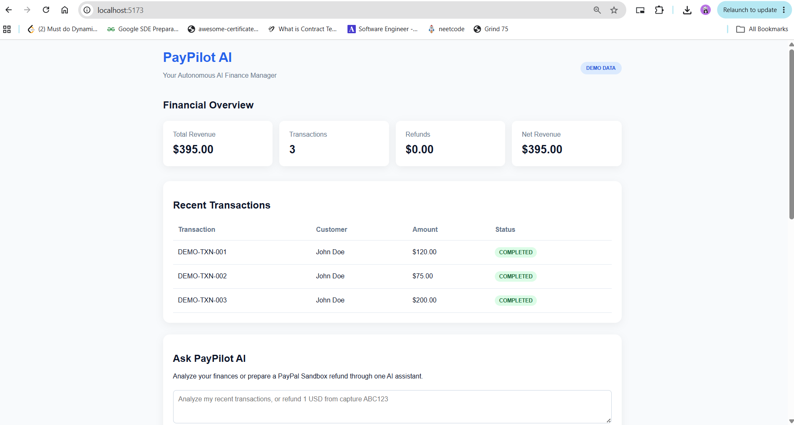
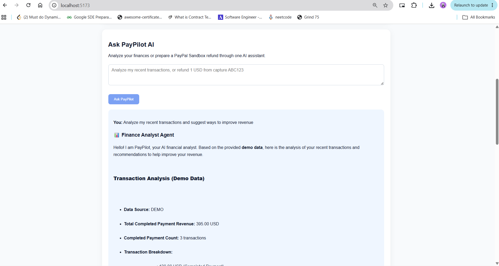
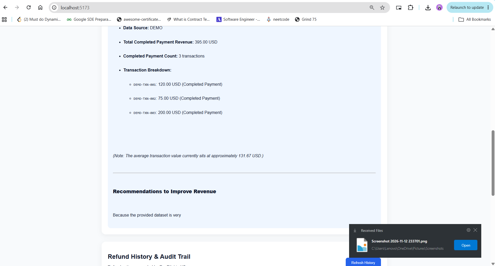
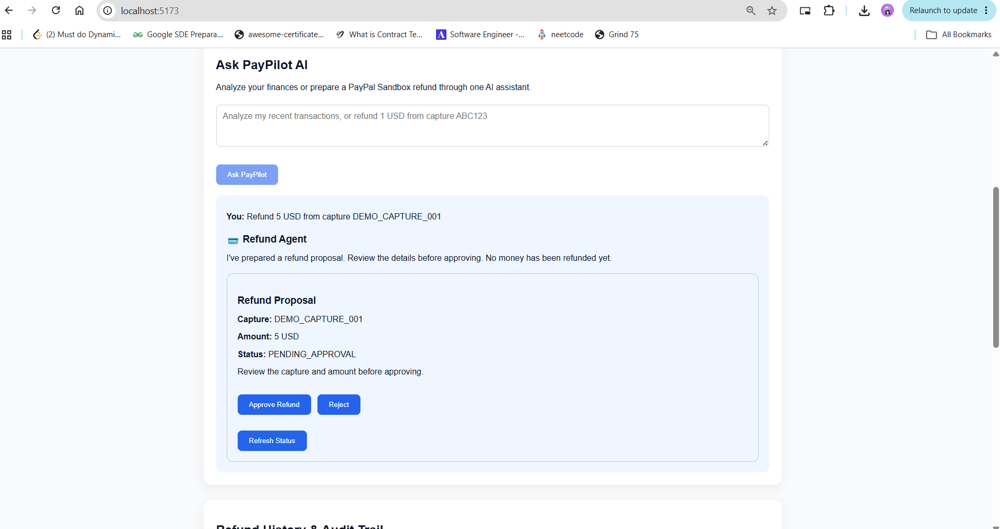
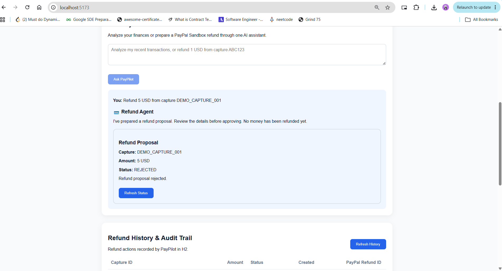
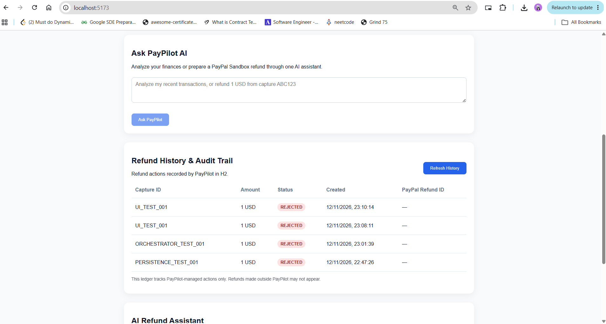
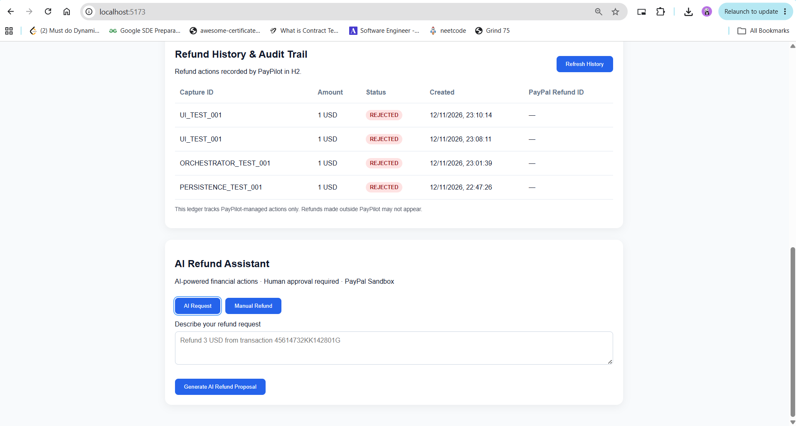
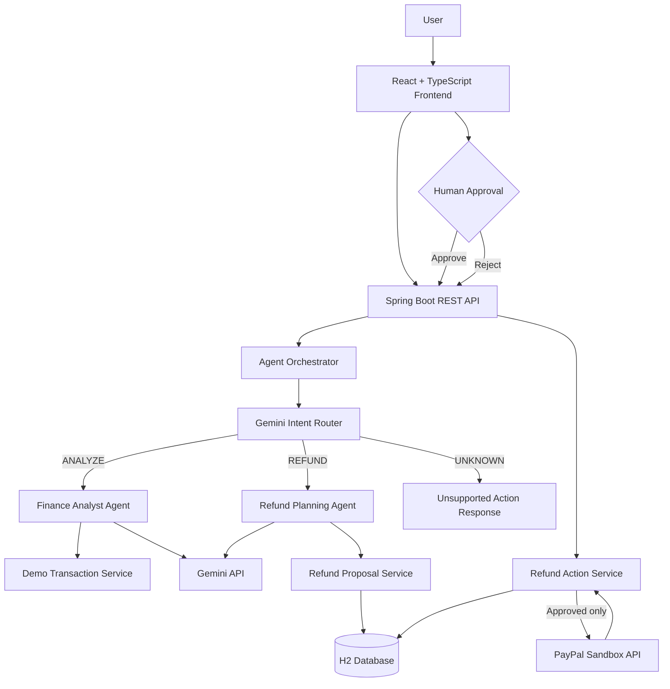

# PayPilot AI

### Your Autonomous AI Finance Manager — with human-approved financial actions

PayPilot AI is a hackathon MVP that helps a business **understand its finances** and **prepare controlled financial actions** through a single natural-language interface. It combines a Gemini-powered finance analyst, an intent router, a refund action planner, a Spring Boot API, a React dashboard, and PayPal Sandbox refund integration.

> **Demo scope:** Dashboard transactions and financial analysis use **sample/demo data**. Refund execution uses **PayPal Sandbox**, not live money. PayPilot is a prototype, not a production financial service.

## Why PayPilot?

Small businesses often have to move between transaction dashboards, reports, and payment tools just to understand what happened and decide what to do next. **PayPilot combines financial insights with controlled, human-approved actions in one conversational workflow.** Rather than being only a chatbot, it routes requests to specialized AI workflows, creates structured refund proposals, and records their status for later review.

## Screenshots

### Financial overview

Demo dashboard with transaction totals and recent payments.



### Gemini-powered Finance Analyst

A natural-language request is routed to the Finance Analyst, which explains the sample transactions and suggests improvements.



<details>
<summary>See the transaction breakdown and recommendations section</summary>



</details>

### AI-generated refund proposal — human approval required

The Refund Agent prepares a proposal for a **fictitious** capture ID. No refund is executed at this stage.



### Refund rejected safely

The proposal is rejected without contacting PayPal to issue a refund.



### Persistent refund history

The H2-backed action ledger shows PayPilot-managed refund proposals and their latest statuses.



<details>
<summary>See the separate AI Refund Assistant interface</summary>



</details>

> **Screenshot note:** The financial dashboard and analysis use demo transactions. The refund proposal and rejection screenshots show a simulated capture ID. A separate PayPal Sandbox refund was verified during development; the screenshots above do not claim that this fictitious capture was refunded.

## What it does

- **Finance Analyst Agent:** Ask questions about recent demo transactions, completed payment revenue, and ways to improve cash flow. Responses are rendered as Markdown.
- **Intent Router:** Classifies requests as `ANALYZE`, `REFUND`, or `UNKNOWN` and directs them to the appropriate workflow.
- **Refund Action Planner:** Uses Gemini to extract a capture ID, amount, and currency from a natural-language refund request.
- **Human-in-the-loop refunds:** Creates a `PENDING_APPROVAL` proposal. Only an explicit approval triggers a PayPal Sandbox refund request; proposals can also be rejected.
- **Persistent refund ledger:** Stores PayPilot-managed refund actions and their latest statuses in an H2 file database, including across backend restarts.
- **Refund history dashboard:** Shows capture IDs, amounts, current statuses, timestamps, and PayPal refund IDs when available.
- **Safety controls:** Rejects duplicate active proposals for a capture, blocks further PayPilot refunds after an approval attempt, and avoids automatically retrying uncertain refund results.

## What makes it different

- **Intent-aware orchestration:** One chat routes analysis, refund requests, and unsupported requests to different safe outcomes.
- **AI plans; humans approve:** Gemini extracts action details, while the backend requires a separate approval before PayPal is called.
- **Persistent action state:** Refund proposals, rejections, and uncertain states remain visible after backend restarts.
- **Honest Sandbox boundary:** Demo financial metrics are kept separate from PayPal Sandbox payment actions.

## Demo workflow

1. Ask **“Analyze my recent transactions and suggest improvements.”** PayPilot routes the request to the Finance Analyst and explains the demo data.
2. Ask **“Refund 1 USD from capture DEMO_CAPTURE_ID.”** PayPilot routes to the Refund Agent and prepares a proposal if the request contains the required fields.
3. Review the proposed capture ID, amount, and currency. **Reject** fictitious demo proposals; never approve a nonexistent capture.
4. Show the saved refund history and how statuses persist after a backend restart.
5. For proof of PayPal integration, show the **previously verified PayPal Sandbox refund** and its confirmation rather than initiating another refund during the demo.

## Architecture



The orchestrator **prepares** financial actions; it does **not** approve or execute them automatically.

## Technology stack

| Layer | Technology |
| --- | --- |
| Frontend | React, TypeScript, Vite, `react-markdown` |
| Backend | Java 21, Spring Boot 4.1.2, Maven |
| AI | Google Gemini API (configured through `GeminiService`) |
| Database | H2 file database, Spring Data JPA |
| Payments | PayPal Sandbox REST API (OAuth, capture lookup, refunds) |
| Local development | Windows PowerShell; no Docker required |

## Project layout

```text
paypilot-ai/
├── README.md
├── screenshots/           # GitHub README images
│   ├── dashboard.png
│   ├── finance-analyst.png
│   ├── finance-analysis-details.png
│   ├── refund-approval.png
│   ├── refund-rejected.png
│   ├── refund-history.png
│   └── refund-assistant.png
├── backend/
│   ├── pom.xml
│   ├── src/main/java/com/paypilot/
│   │   ├── controller/       # REST endpoints
│   │   ├── service/          # AI routing, analysis, refunds
│   │   ├── model/            # API/domain models
│   │   ├── entity/           # H2 persistence entity
│   │   └── repository/       # Spring Data repository
│   └── src/main/resources/
│       └── application.properties
└── frontend/
    ├── src/
    │   ├── App.tsx
    │   └── components/
    │       ├── RefundApproval.tsx
    │       ├── RefundProposalCard.tsx
    │       └── RefundHistory.tsx
    └── package.json
```

## Prerequisites

- **JDK 21**
- **Node.js and npm** (Node.js 20 or later recommended)
- A **Google Gemini API key** with access to the configured model
- A **PayPal Developer Sandbox REST app**, with client ID and secret
- Windows PowerShell for the commands below (equivalent commands work on other platforms)

No Docker or external PostgreSQL instance is needed.

## Local setup

### 1. Clone the repository

```powershell
git clone <YOUR_REPOSITORY_URL>
cd paypilot-ai
```

### 2. Configure secrets for the backend

Set the environment variables **in the same PowerShell session used to start Spring Boot**:

```powershell
$env:GOOGLE_API_KEY = "YOUR_GEMINI_API_KEY"
$env:PAYPAL_CLIENT_ID = "YOUR_SANDBOX_CLIENT_ID"
$env:PAYPAL_CLIENT_SECRET = "YOUR_SANDBOX_CLIENT_SECRET"
```

Do not commit credentials to Git or paste real keys into issues or screenshots. A new terminal may not inherit variables set in another terminal.

### 3. Configure `backend/src/main/resources/application.properties`

Keep existing application-specific settings, including any Gemini model configuration. Ensure the following settings are present:

```properties
# Gemini key is read from the environment
gemini.api.key=${GOOGLE_API_KEY}

# PayPal Sandbox
paypal.base-url=https://api-m.sandbox.paypal.com
paypal.client-id=${PAYPAL_CLIENT_ID}
paypal.client-secret=${PAYPAL_CLIENT_SECRET}

# Persistent H2 database
spring.datasource.url=jdbc:h2:file:./data/paypilot;DB_CLOSE_ON_EXIT=FALSE
spring.datasource.driver-class-name=org.h2.Driver
spring.datasource.username=sa
spring.datasource.password=
spring.jpa.hibernate.ddl-auto=update
spring.jpa.open-in-view=false

# Development only
spring.h2.console.enabled=true
spring.h2.console.path=/h2-console
```

> Verify that the Gemini model configured in your existing project is available to your API key. H2 console and `ddl-auto=update` are development conveniences, not production settings.

### 4. Run the backend

```powershell
cd backend
.\mvnw.cmd clean compile
.\mvnw.cmd spring-boot:run
```

Backend: **http://localhost:8080**

The H2 database files are created relative to the backend working directory, under `backend/data/` when launched there.

### 5. Run the frontend

Open a **second terminal**:

```powershell
cd frontend
npm install
npm run dev
```

Frontend: **http://localhost:5173**

The Vite development server proxies `/api` requests to the backend according to the project's Vite configuration.

### 6. Check the production frontend build

```powershell
cd frontend
npm run build
```

## API overview

| Method | Endpoint | Purpose |
| --- | --- | --- |
| `GET` | `/api/health` | Backend health |
| `GET` | `/api/transactions` | Demo transactions |
| `GET` | `/api/transactions/summary` | Demo dashboard metrics |
| `POST` | `/api/agent/analyze` | Finance analysis (legacy/direct endpoint) |
| `POST` | `/api/agent/intent` | Classify request intent |
| `POST` | `/api/agent/plan` | Extract structured action plan |
| `POST` | `/api/agent/orchestrate` | Unified finance/refund agent workflow |
| `POST` | `/api/agent/refund/propose` | Direct AI refund proposal |
| `POST` | `/api/actions/refund/propose` | Manual refund proposal |
| `GET` | `/api/actions/{id}` | Fetch an action and its status |
| `POST` | `/api/actions/{id}/approve` | Explicitly approve a Sandbox refund |
| `POST` | `/api/actions/{id}/reject` | Reject a pending proposal |
| `GET` | `/api/actions/history` | Saved PayPilot refund actions |
| `GET` | `/api/paypal/status` | Sandbox API connectivity |

### Example: analyze finances

```powershell
$body = @{ message = "Analyze my recent transactions" } | ConvertTo-Json
Invoke-RestMethod `
  -Uri "http://localhost:8080/api/agent/orchestrate" `
  -Method Post `
  -ContentType "application/json" `
  -Body $body
```

Expected intent: `ANALYZE` with an AI-generated explanation based on **demo data**.

### Example: propose a refund (no PayPal execution)

```powershell
$body = @{
  message = "Refund 1 USD from capture README_TEST_001"
} | ConvertTo-Json

Invoke-RestMethod `
  -Uri "http://localhost:8080/api/agent/orchestrate" `
  -Method Post `
  -ContentType "application/json" `
  -Body $body
```

Expected intent: `REFUND`, with a `refundAction` in `PENDING_APPROVAL` if Gemini extracts the fields successfully. This **does not execute a refund**. Reject the fictitious proposal using its returned ID; **never approve** a fictitious capture ID.

## Refund state model

```text
PENDING_APPROVAL ── Reject ──────────────> REJECTED
        │
        └── Explicit Approve ────────────> PROCESSING
                                               │
                                               └── Confirmed PayPal completion ──> COMPLETED
```

If the PayPal result is missing, delayed, or ambiguous, the action remains `PROCESSING` and the capture remains blocked in PayPilot pending manual reconciliation. The model also defines `FAILED`, but the current flow deliberately does not automatically mark ambiguous PayPal responses as failed.

### Safety notes

- A proposal is **not** a refund. Approval is a separate API call and requires explicit user confirmation in the UI.
- PayPilot uses the action UUID as a PayPal request idempotency key.
- Once an approval attempt starts, PayPilot conservatively blocks additional refunds on that capture in its own ledger, including after restarts.
- The capture API's **original amount** is not proof of the **remaining refundable amount**. Refunds performed directly in PayPal may not be visible to PayPilot.
- PayPal Transaction Search returned `403 NOT_AUTHORIZED` in the development Sandbox, and the reporting/search scope was absent from the app's OAuth token. **External refund reconciliation is therefore not implemented.**
- The in-process capture locks are appropriate only for this single-instance MVP; they do not guarantee safety with multiple backend instances or external writers.
- The current ledger stores each action's **latest state**, not a complete immutable event-by-event audit log.
- This prototype does not implement production authentication, role-based approval permissions, or a full payment risk/compliance review. Do not expose it publicly or use live credentials.

## Tests performed

The following were manually verified during development:

- Backend health and refund-history endpoints
- Finance Analyst and unsupported-action routing
- `ANALYZE`, `REFUND`, and `UNKNOWN` intent classification
- AI-generated refund proposal creation and explicit rejection
- Duplicate pending refund proposal prevention (`409 Conflict`)
- Persistence of refund actions across backend restarts
- React unified chat, refund proposal/rejection UI, and history table
- A **previously completed $2 PayPal Sandbox refund**, confirmed in PayPal

These are **manual MVP tests**, not a claim of complete automated test coverage or production safety.

## Suggested three-minute hackathon demo

| Time | Show |
| --- | --- |
| 0:00–0:25 | Problem and PayPilot overview |
| 0:25–1:05 | Ask the Finance Analyst to explain demo transactions |
| 1:05–2:00 | Ask for a refund, inspect proposal, reject fictitious test request |
| 2:00–2:30 | Show evidence of the previously verified PayPal Sandbox refund |
| 2:30–3:00 | Show H2 refund history, architecture, and safety boundaries |

## Known limitations and next steps

- Replace demo transactions with authorized real transaction data when reporting permissions are available.
- Add authoritative refund reconciliation and remaining-refundable-balance checks before expanding refund execution.
- Add authentication, authorization, approval roles, audit events, and stronger concurrency controls.
- Add automated integration tests and production-grade error handling.
- Extend supported actions beyond refunds only after introducing appropriate permissions and safeguards.

## Security and repository hygiene

Before publishing, ensure `.gitignore` excludes at least:

```gitignore
# Credentials / local configuration
.env
.env.*
!.env.example

# Local database files
backend/data/
*.mv.db
*.trace.db

# Build outputs
backend/target/
frontend/node_modules/
frontend/dist/

# IDE
.idea/
.vscode/
```

**Important:** `.gitignore` does not remove secrets already tracked by Git. Review the repository and commit history for credentials before making it public. Keep environment-specific credentials out of `application.properties`.

---

**PayPilot AI** — AI-assisted financial insights and human-approved financial actions, built as a PayPal hackathon prototype.
